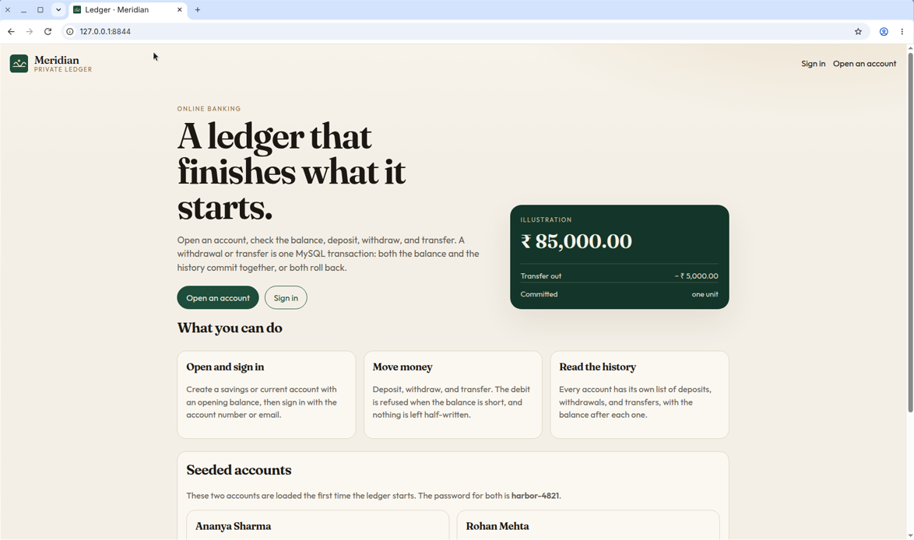
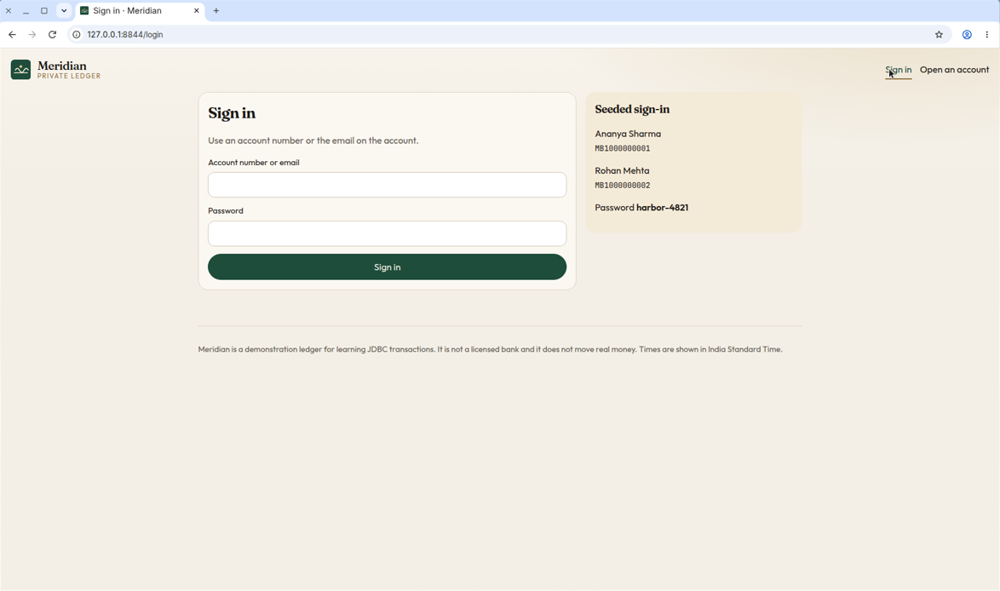
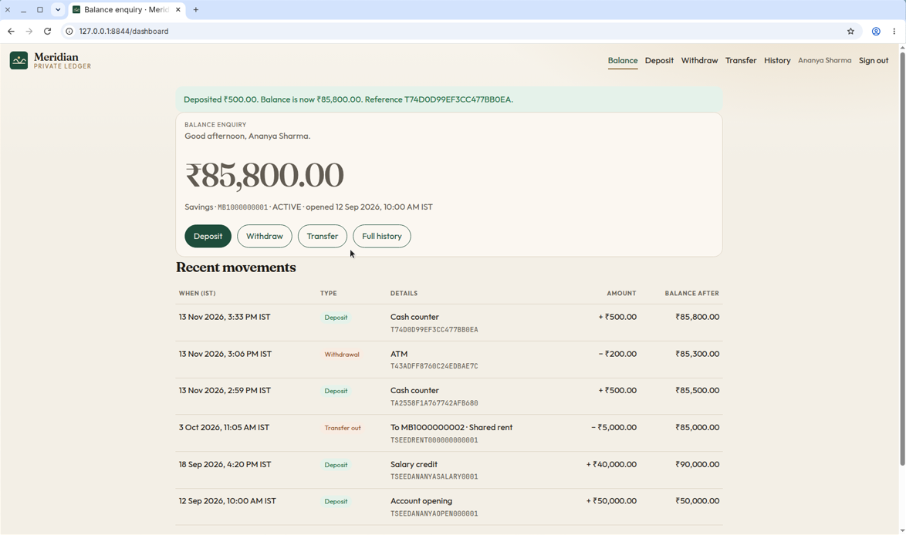
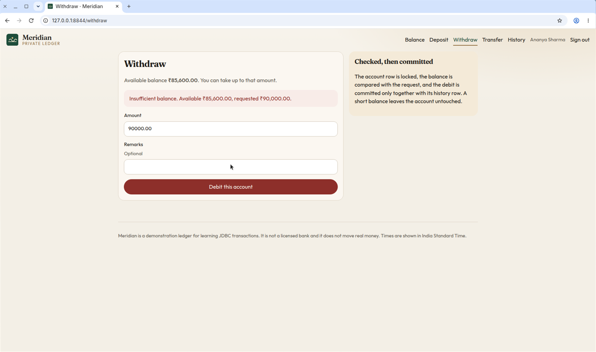
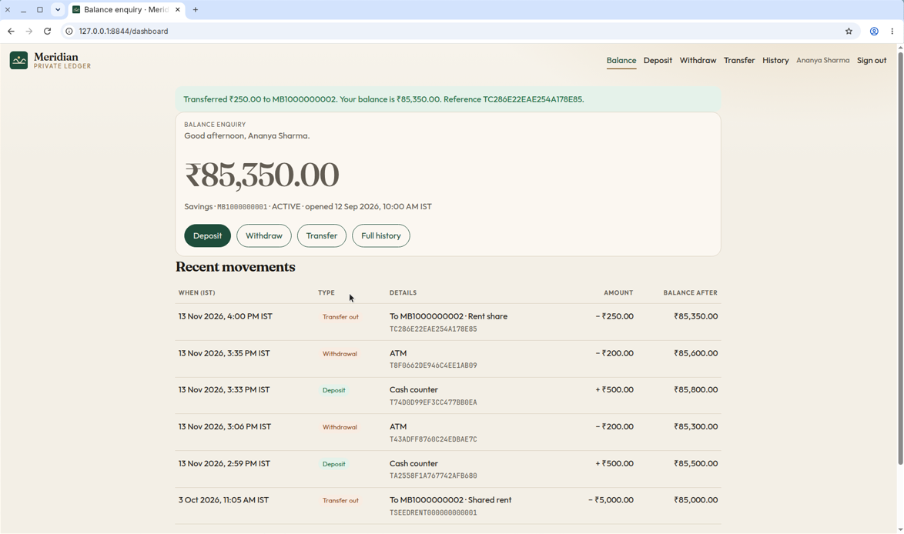
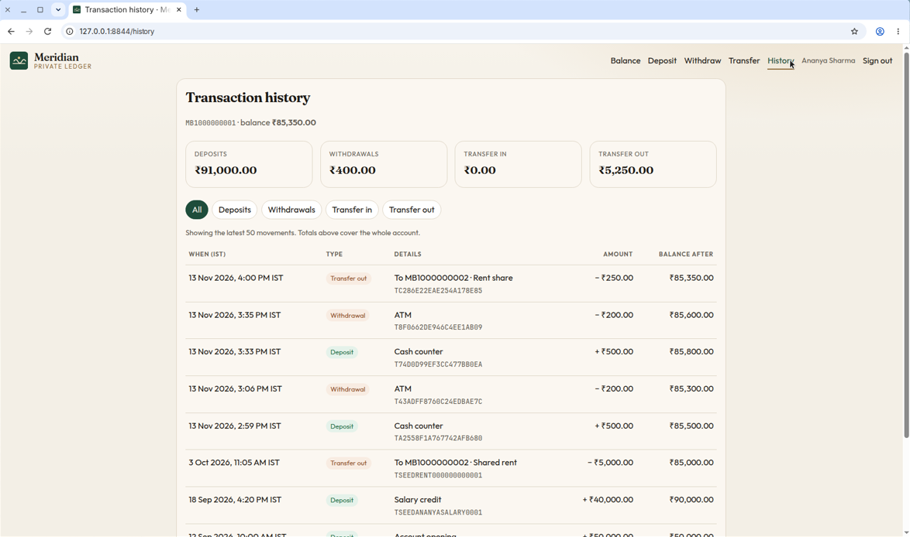
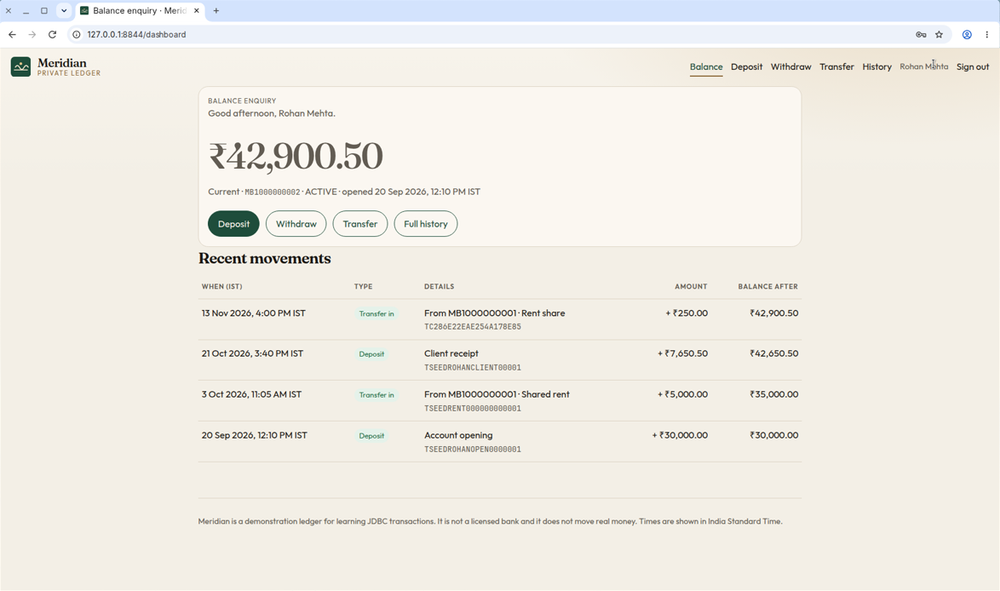
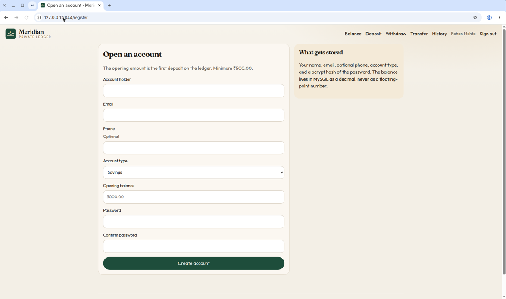

# Meridian Bank

Meridian is a small online-banking ledger. You can open an account, sign in, check the balance, deposit, withdraw, transfer to another account, and read that account's history.

It is a demonstration. It is not a licensed bank and it does not move real money.

## Screenshots

These are the running ledger. Times are India Standard Time.



The home page lists what the ledger does and the two seeded accounts.



Sign in with an account number or email. The seeded password is on the page.



A ₹500.00 cash deposit commits and the balance enquiry shows ₹85,800.00.



A withdrawal of ₹90,000.00 is refused. Available balance stays ₹85,600.00.



₹250.00 sent from Ananya Sharma to `MB1000000002`. Her balance is ₹85,350.00, and the history row is written in the same commit.



Ananya's history, with deposits, withdrawals, and transfers, plus the balance after each one.



Rohan Mehta's balance is ₹42,900.50. The same transfer is a credit of ₹250.00 on his account.



A new savings or current account starts with an opening deposit. The password is stored as a bcrypt hash.

## Sample accounts

Both seeded accounts use the password `harbor-4821`. The amounts in this table are the opening balances inserted when the ledger is empty. The screenshots above are from a ledger that has already posted salary, rent, and the deposit, withdrawal, and transfer shown there.


| Holder | Account | Type | Balance |
| --- | --- | --- | --- |
| Ananya Sharma | `MB1000000001` | Savings | ₹85,000.00 |
| Rohan Mehta | `MB1000000002` | Current | ₹42,650.50 |

You can also sign in with `ananya.sharma@meridian.demo` or `rohan.mehta@meridian.demo`.

## Run with Docker

```bash
docker compose up --build
```

Open `http://127.0.0.1:8844/`. MySQL is published on port 3307 so it does not collide with a database already using 3306. The compose file is for local use; its database password is a sample value, not a production secret.

## Run with Maven and Tomcat

You need JDK 17+, Maven 3.8+, MySQL 8, and Apache Tomcat 10.1.

```bash
mysql -u root < scripts/init-mysql.sql
mvn test
export CATALINA_HOME=/opt/tomcat
./scripts/run-local.sh
```

`scripts/run-local.sh` builds `target/meridian-bank.war` and deploys it as the ROOT application. Point Tomcat's HTTP connector at port 8844 if you want the same address as the Docker setup. The app reads `DB_URL`, `DB_USER`, and `DB_PASSWORD`. When those are unset it uses `bankuser` / `meridian_local` on `127.0.0.1:3306/meridian_bank`.

On startup the application creates the tables and, if the ledger is empty, inserts the two sample accounts.

## How a transfer stays consistent

Withdrawals and transfers use a single JDBC transaction. The account rows are locked, the balance is checked, and the balance update plus the history rows commit together. If any step fails, the transaction rolls back, so a failed debit never leaves an account half-updated.

`BankService.transfer` does this inside one connection with auto-commit off:

1. Lock the two account rows with `SELECT ... FOR UPDATE`, lower account number first, so two opposite transfers cannot deadlock.
2. Refuse the transfer when the source balance is short, or when the recipient does not exist. That refusal rolls back.
3. Debit the source, credit the destination, and insert both history rows under one reference.
4. Commit. Any SQL failure rolls the whole unit back.

The same commit-or-rollback path is used for deposits and withdrawals. Money is stored as `DECIMAL`, and the Java side uses `BigDecimal`.

Custom exceptions cover an insufficient balance, an invalid account, a bad amount, and a failed sign-in. Passwords are stored as bcrypt hashes. Queries use prepared statements. Money forms carry a CSRF token, and pages escape values when they render them.

## Layout

Servlets are the controllers, JSP files under `src/main/webapp` are the views, and `com.meridian.bank.model` holds the account and ledger objects. JDBC lives behind `AccountDao` and `TransactionDao`.

## Jenkins

`Jenkinsfile` checks out the repo, runs `mvn test`, packages the WAR, and uploads it to the Tomcat manager. Add a Jenkins username/password credential named `tomcat-manager`. The Tomcat user needs the `manager-script` role. Pass `TOMCAT_URL` if the manager is not on `http://127.0.0.1:8080`.

## Ansible

Install the collection, then build and push the image:

```bash
ansible-galaxy collection install community.docker
ansible-playbook ansible/build-push.yml \
  -e dockerhub_username=YOUR_ID \
  -e dockerhub_password=YOUR_TOKEN
```

The token is an extra variable. It is not stored in the playbook.

## Kubernetes

The manifests in `k8s/` are a namespace, MySQL, a Deployment, and a LoadBalancer Service sized for an EKS-style cluster. Session affinity is `ClientIP` because sign-in state is kept in Tomcat memory.

```bash
kubectl apply -f k8s/namespace.yaml
kubectl apply -f k8s/configmap.yaml
kubectl apply -f k8s/secret.yaml
kubectl apply -f k8s/mysql.yaml
kubectl apply -f k8s/deployment.yaml
kubectl apply -f k8s/service.yaml
```

Replace `YOUR_DOCKERHUB_ID` in `k8s/deployment.yaml` with the image Ansible pushed. Replace the sample secret before using a shared cluster. If MySQL is Amazon RDS instead of the bundled deployment, point `DB_URL` at that host and skip `k8s/mysql.yaml`.

## Files for GitHub

`online-banking-fund-transfer.zip` is this project packed for download or a GitHub release. It includes the Java sources, JSP pages, tests, Docker, Jenkins, Ansible, Kubernetes manifests, this README, and the screenshots. It leaves out `target/` and `.git`.

To put the unpacked tree on GitHub:

```bash
unzip online-banking-fund-transfer.zip -d meridian-bank
cd meridian-bank
git init
git add .
git commit -m "Add Meridian online banking ledger"
git branch -M main
git remote add origin git@github.com:YOUR_USER/meridian-bank.git
git push -u origin main
```

If this folder is already a clone, commit and push it directly. The zip is the same tree.

## Tests

`mvn test` checks amount parsing, password hashing, lock ordering, and, when MySQL is reachable, the ledger itself. The database tests register accounts, transfer, refuse an overdraft, and simulate a failure while the credit row is being written. After that failure both balances are unchanged.
